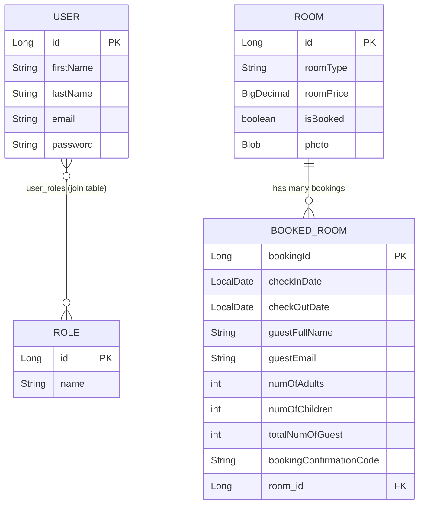
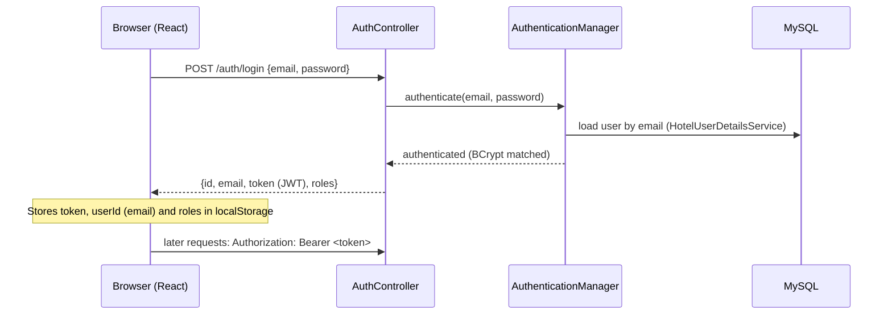

# Lakeside Hotel – Hotel Booking System

A full-stack hotel booking application. Guests can browse rooms, search by date range and room type, and book a room. Admins can manage rooms, bookings and users. The backend is a **Spring Boot REST API** secured with **JWT**, backed by **MySQL**. The frontend is a **React** single-page app.

---

## Table of Contents

1. [Features](#1-features)
2. [Tech Stack](#2-tech-stack)
3. [Architecture](#3-architecture)
4. [Project Structure](#4-project-structure)
5. [Data Model](#5-data-model)
6. [How It Works (Walkthroughs)](#6-how-it-works-walkthroughs)
7. [Key Concepts Used](#7-key-concepts-used)
8. [API Reference](#8-api-reference)
9. [Frontend Routes](#9-frontend-routes)
10. [Run Locally](#10-run-locally)
11. [Deploy on AWS](#11-deploy-on-aws)
12. [Known Limitations and Future Improvements](#12-known-limitations-and-future-improvements)
13. [Author](#13-author)

---

## 1. Features

**Guest / User**
- Register and log in (JWT-based authentication)
- Browse all rooms (home-page carousel and a paginated listing)
- Search available rooms by **check-in date, check-out date and room type**
- Book a room: enter guest details and dates, review a booking summary with the total price, then confirm
- Receive a **10-digit confirmation code** after booking
- Look up a booking by confirmation code and cancel it
- Profile page: view account details and your bookings, delete your account

**Admin**
- Add a room with a photo, type and price
- Edit or delete existing rooms (with room-type filter and pagination)
- View all bookings, filter them by date range, and cancel bookings
- Role management API (create roles, assign or remove roles for users)

---

## 2. Tech Stack

| Layer | Technology |
|---|---|
| Backend language | Java 17 |
| Backend framework | Spring Boot 3.5.3 (Web, Data JPA, Security, Validation) |
| Authentication | Spring Security, JWT (jjwt 0.11.5), BCrypt password hashing |
| ORM / Database | Hibernate (JPA), MySQL |
| Build tool | Maven (wrapper included) |
| Utilities | Lombok, Apache Commons Lang3 |
| Frontend | React 19, Vite 6 |
| UI | Bootstrap 5, React-Bootstrap, React Icons |
| Frontend libraries | React Router 7, Axios, jwt-decode, Moment.js, date-fns, react-date-range |

---

## 3. Architecture

```
┌──────────────────────┐        HTTP + JSON         ┌─────────────────────────────┐        JDBC        ┌─────────┐
│  React frontend      │  ───────────────────────►  │  Spring Boot REST API       │  ───────────────►  │  MySQL  │
│  (Vite, port 5173)   │  Authorization: Bearer JWT │  (port 9000)                │   Hibernate / JPA  │         │
└──────────────────────┘  ◄───────────────────────  └─────────────────────────────┘  ◄───────────────  └─────────┘
```

### Backend layers

```
Request ─► Security filter chain (CORS ► JWT filter ► authorization rules)
        ─► Controller      (HTTP: routes, status codes, request/response mapping)
        ─► Service         (business logic; interface + implementation)
        ─► Repository      (Spring Data JPA: database access)
        ─► MySQL
```

| Layer | Responsibility | Examples |
|---|---|---|
| `controller` | Receives HTTP requests, returns responses | `RoomController`, `BookingController`, `AuthController` |
| `service` | Business rules (availability check, registration, role handling) | `IBookingService` / `BookingServiceImpl` |
| `repository` | Database queries via Spring Data JPA | `RoomRepository`, `BookingRepository` |
| `model` | JPA entities (tables) | `Room`, `BookedRoom`, `User`, `Role` |
| `response` / `request` | DTOs: shapes of data sent to and from clients | `RoomResponse`, `BookingResponse`, `JwtResponse`, `LoginRequest` |
| `exception` | Custom exceptions | `ResourceNotFoundException`, `InvalidBookingRequestException` |
| `security` | JWT, user details, CORS, authorization rules | `WebSecurityConfig`, `AuthTokenFilter`, `JwtUtils` |

Each service is declared as an **interface** (`IRoomService`) with an **implementation** (`RoomServiceImpl`). Controllers depend on the interface, which keeps layers loosely coupled and easy to test or replace.

---

## 4. Project Structure

```
Hotel-Booking-App/
├── lakeside-hotel-backend/
│   ├── pom.xml
│   └── src/main/java/com/project/lakeside_hotel_backend/
│       ├── LakesideHotelBackendApplication.java   # entry point
│       ├── controller/      # Auth, Room, Booking, User, Role controllers
│       ├── service/         # bookedRoom/, room/, user/, role/  (interface + impl)
│       ├── repository/      # Room, Booking, User, Role repositories
│       ├── model/           # Room, BookedRoom, User, Role entities
│       ├── request/         # LoginRequest
│       ├── response/        # RoomResponse, BookingResponse, JwtResponse
│       ├── exception/       # custom exception classes
│       └── security/
│           ├── WebSecurityConfig.java   # filter chain, password encoder
│           ├── CorsConfig.java          # allowed origin / headers / methods
│           ├── jwt/                     # AuthTokenFilter, JwtUtils, JwtAuthEntryPoint
│           └── user/                    # HotelUserDetails, HotelUserDetailsService
│
└── lakeside-hotel-frontend/
    ├── package.json
    └── src/
        ├── main.jsx            # React entry: AuthProvider + BrowserRouter
        ├── App.jsx             # all routes
        └── components/
            ├── admin/          # admin dashboard
            ├── auth/           # Login, Registration, Profile, Logout, AuthProvider, RequireAuth
            ├── bookings/       # BookingForm, BookingSummary, CheckOut, FindBooking, Bookings, BookingsTable
            ├── common/         # RoomSearch, RoomCarousel, RoomFilter, RoomPaginator, DateSlider, ...
            ├── home/           # Home page
            ├── layout/         # Navbar, Footer, MainHeader
            ├── room/           # AddRoom, EditRoom, ExistingRooms, RoomListing, RoomCard
            └── utils/
                └── ApiFunctions.js   # every Axios call to the backend lives here
```

---

## 5. Data Model



Relationships:
- **User ↔ Role** is many-to-many through the `user_roles` table. Roles are loaded **eagerly** with the user because Spring Security needs them on every authenticated request.
- **Room → BookedRoom** is one-to-many. `BookedRoom` holds the foreign key `room_id`. Bookings are loaded **lazily** (only when accessed).
- A booking is linked to a guest by the **email string** (`guestEmail`), not by a foreign key to `User`.
- The room photo is stored in the database as a `Blob` and sent to the browser as a Base64 string.

Hibernate creates and updates the tables automatically when `spring.jpa.hibernate.ddl-auto=update` is set.

---

## 6. How It Works (Walkthroughs)

### 6.1 Registration

1. The React `Registration` form calls `POST /auth/register` with first name, last name, email and password.
2. `AuthController` calls `UserServiceImpl.registerUser`.
3. The service checks `existsByEmail`. If the email exists, it throws `UserAlreadyExistsException` (HTTP 409).
4. The password is hashed with **BCrypt**, the `ROLE_USER` role is attached and the user is saved.

### 6.2 Login and JWT



- On success the backend signs a JWT (HS256) containing the **subject** (email), the **roles** and an **expiry**.
- The frontend (`AuthProvider`) decodes the token with `jwt-decode` and saves `token`, `userId` (this is the email) and `userRole` in `localStorage`.
- `ApiFunctions.getHeader()` attaches `Authorization: Bearer <token>` to protected calls.

### 6.3 What happens on every protected request

1. `AuthTokenFilter` (runs before Spring's username/password filter) reads the `Authorization` header and strips `Bearer `.
2. `JwtUtils.validateToken` verifies the signature and expiry.
3. If valid, the email is read from the token, the user is loaded and a `SecurityContext` authentication is set.
4. Authorization rules then decide access: URL rules in `WebSecurityConfig` and method rules such as `@PreAuthorize("hasRole('ROLE_ADMIN')")`.
5. Invalid or missing tokens on protected routes are rejected by `JwtAuthEntryPoint` (HTTP 401).

The API is **stateless**: no server-side session. The token carries the identity.

### 6.4 Searching for available rooms

1. The home page `RoomSearch` sends `GET /rooms/available-rooms?checkInDate=...&checkOutDate=...&roomType=...`.
2. `RoomRepository.findAvailableRoomsByDatesAndType` runs a JPQL query that returns rooms of that type **not** having a booking that overlaps the requested dates. Two ranges overlap when `existing.checkIn <= requested.checkOut AND existing.checkOut >= requested.checkIn`.
3. The controller converts each photo to Base64 and returns `RoomResponse` objects. The result is shown as paginated `RoomCard`s.

### 6.5 Booking a room

1. The user clicks a room and is sent to `/book-room/:roomId` (protected by `RequireAuth`, so login is needed).
2. `BookingForm` collects name, email, dates and guest counts. It validates on the client (required fields, at least one adult, check-out not before check-in).
3. `BookingSummary` shows nights × price as the total. After the user confirms (with a short simulated "processing payment" delay; there is no real payment gateway), it calls `POST /bookings/room/{roomId}/booking`.
4. `BookingServiceImpl.saveBookings` checks that check-out is not before check-in and that the room is available for those dates.
5. `Room.addBookings` links the booking to the room, marks the room as booked and generates a random **10-digit confirmation code**.
6. The code is returned and shown on the success page. The guest can later look the booking up with it on `/find-bookings`.

### 6.6 Admin adding a room

1. `AddRoom` sends a `multipart/form-data` request (`photo`, `roomType`, `roomPrice`) to `POST /rooms/add/new-room`.
2. The endpoint requires `ROLE_ADMIN`. The service turns the uploaded file into a `SerialBlob` and saves the `Room`.
3. The frontend only shows admin pages to users whose stored role is `ROLE_ADMIN` (`RequireAuth requireAdmin`). The real protection is on the backend.

---

## 7. Key Concepts Used

| Concept | Where / why it is used |
|---|---|
| **REST API** | Resource-based URLs with `GET/POST/PUT/DELETE` and JSON bodies |
| **Dependency Injection** | Constructor injection through Lombok `@RequiredArgsConstructor` |
| **JPA / Hibernate (ORM)** | Java classes (`@Entity`) map to tables; repositories replace hand-written SQL |
| **Spring Data JPA** | `JpaRepository` gives CRUD for free; derived queries like `findByEmail`; custom JPQL with `@Query` |
| **Lazy vs Eager loading** | `Room.bookings` is lazy (loaded on demand), `User.roles` is eager (needed for security) |
| **DTOs** | `RoomResponse` and `BookingResponse` control what the API returns |
| **JWT** | Signed token with email, roles and expiry; verified on every request |
| **BCrypt** | One-way salted password hashing; plain passwords are never stored |
| **Stateless sessions** | `SessionCreationPolicy.STATELESS`; no HTTP session |
| **Method-level security** | `@EnableMethodSecurity` and `@PreAuthorize` for role checks |
| **CORS** | `CorsConfig` allows the React dev origin to call the API from the browser |
| **CSRF disabled** | Acceptable for a stateless token API that does not use cookies for auth |
| **Custom exceptions** | Thrown by services and turned into HTTP responses (404, 400, 409) with `try/catch` in the controllers |
| **React Context** | `AuthProvider` shares login state across components |
| **Protected routes** | `RequireAuth` wrapper redirects unauthenticated users to `/login` |
| **Multipart upload** | Room photos uploaded as `multipart/form-data` |

---

## 8. API Reference

Base URL (local): `http://localhost:9000`

"Auth" is the access level actually enforced by the backend today.

### Authentication

| Method | Endpoint | Auth | Description |
|---|---|---|---|
| POST | `/auth/register` | Public | Register a user (gets `ROLE_USER`) |
| POST | `/auth/login` | Public | Returns `{ id, email, token, roles }` |

### Rooms

| Method | Endpoint | Auth | Description |
|---|---|---|---|
| GET | `/rooms/all-rooms` | Public | All rooms with Base64 photos |
| GET | `/rooms/room/types` | Public | Distinct room types |
| GET | `/rooms/room/{roomId}` | Public | One room |
| GET | `/rooms/available-rooms?checkInDate=YYYY-MM-DD&checkOutDate=YYYY-MM-DD&roomType=` | Public | Rooms free for the dates |
| POST | `/rooms/add/new-room` | Admin | Multipart: `photo`, `roomType`, `roomPrice` |
| PUT | `/rooms/update/{roomId}` | Admin | Update type, price and/or photo |
| DELETE | `/rooms/delete/room/{roomId}` | Admin | Delete a room |

### Bookings

| Method | Endpoint | Auth | Description |
|---|---|---|---|
| GET | `/bookings/all-bookings` | Admin | All bookings |
| POST | `/bookings/room/{roomId}/booking` | Public* | Create a booking, returns the confirmation code |
| GET | `/bookings/confirmation/{code}` | Public | Find a booking by code |
| GET | `/bookings/user/{email}/bookings` | Public* | Bookings of a guest email |
| DELETE | `/bookings/booking/{bookingId}/delete` | Public* | Cancel a booking |

\* See [limitations](#12-known-limitations-and-future-improvements). The UI requires login for booking, but the API rules for these endpoints are open.

### Users

| Method | Endpoint | Auth | Description |
|---|---|---|---|
| GET | `/users/all` | Admin | List users |
| GET | `/users/{email}` | Admin or User | Get a user by email |
| DELETE | `/users/delete/{email}` | Admin, or the user themself | Delete a user |

### Roles (all require Admin)

| Method | Endpoint | Description |
|---|---|---|
| GET | `/roles/all-roles` | List roles |
| POST | `/roles/create-new-role` | Create a role (`ROLE_` prefix added automatically) |
| DELETE | `/roles/delete/{roleId}` | Delete a role |
| POST | `/roles/assign-role-to-user?userId=&roleId=` | Assign a role |
| POST | `/roles/remove-user-from-role?userId=&roleId=` | Remove a user from a role |
| POST | `/roles/remove-all-users-from-role/{roleId}` | Remove all users from a role |

### Example: login and call a protected endpoint

```bash
# 1. Log in
curl -s -X POST http://localhost:9000/auth/login \
  -H "Content-Type: application/json" \
  -d '{"email":"admin@example.com","password":"your-password"}'

# 2. Use the token from the response
curl -s http://localhost:9000/bookings/all-bookings \
  -H "Authorization: Bearer <TOKEN>"
```

---

## 9. Frontend Routes

| Path | Page | Access |
|---|---|---|
| `/` | Home: search, carousel, services | Public |
| `/browse-all-rooms` | Room listing | Public |
| `/find-bookings` | Find / cancel a booking by confirmation code | Public |
| `/booking-success` | Booking result message | Public |
| `/login`, `/register` | Authentication | Public |
| `/book-room/:roomId` | Booking form and summary | Logged in |
| `/profile` | Account details and your bookings | Logged in |
| `/admin` | Admin dashboard | Admin |
| `/existing-rooms` | Manage rooms | Admin |
| `/add-room` | Add a room | Admin |
| `/edit-room/:roomId` | Edit a room | Admin |
| `/existing-bookings` | All bookings (date filter) | Admin |

---

## 10. Run Locally

### 10.1 Prerequisites

- JDK 17
- Node.js 18 or newer (20 recommended) and npm
- MySQL 8 (installed locally, or run it in Docker)
- Git

### 10.2 Database

Option A: Docker

```bash
docker run --name lakeside-mysql \
  -e MYSQL_ROOT_PASSWORD=root123 \
  -e MYSQL_DATABASE=lakeside_hotel_db \
  -p 3306:3306 -d mysql:8
```

Option B: local MySQL

```sql
CREATE DATABASE lakeside_hotel_db;
```

### 10.3 Backend configuration

`application.properties` is **git-ignored**, so create it yourself at
`lakeside-hotel-backend/src/main/resources/application.properties`:

```properties
server.port=9000

# Database
spring.datasource.url=jdbc:mysql://localhost:3306/lakeside_hotel_db
spring.datasource.username=root
spring.datasource.password=root123
spring.jpa.hibernate.ddl-auto=update
spring.jpa.show-sql=true

# Room photos: Spring's default upload limit is 1MB
spring.servlet.multipart.max-file-size=10MB
spring.servlet.multipart.max-request-size=10MB

# JWT: the secret must be Base64 and at least 32 bytes (256 bits) for HS256
auth.token.jwtSecret=PASTE_BASE64_SECRET_HERE
auth.token.expirationTime=3600000
```

Generate a secret:

```bash
openssl rand -base64 32
```

Notes:
- `server.port=9000` matches the hard-coded API address in `ApiFunctions.js`.
- `auth.token.expirationTime` is in **milliseconds** (3600000 = 1 hour).

### 10.4 Start the backend

```bash
cd lakeside-hotel-backend
./mvnw spring-boot:run          # Windows: mvnw.cmd spring-boot:run
```

On the first start Hibernate creates the tables (`user`, `role`, `user_roles`, `room`, `booked_room`).

### 10.5 Seed the roles (required once)

The code does **not** create roles automatically, and registration looks up `ROLE_USER`. Without these rows, registration fails.

```sql
USE lakeside_hotel_db;
INSERT INTO role (name) VALUES ('ROLE_USER'), ('ROLE_ADMIN');
```

### 10.6 Start the frontend

```bash
cd lakeside-hotel-frontend
npm install
npm run dev
```

Open **http://localhost:5173**. This origin is the one the backend CORS configuration allows.

### 10.7 Create an admin user

There is no admin sign-up screen. Do this once:

1. Register a normal user through the UI (`/register`).
2. Switch that user to the admin role in the database:

```sql
UPDATE user_roles
SET role_id = (SELECT id FROM role WHERE name = 'ROLE_ADMIN')
WHERE user_id = (SELECT id FROM `user` WHERE email = 'admin@example.com');
```

3. Log out and log in again so a new token with the admin role is issued.

> The admin must have **only** `ROLE_ADMIN` (replace the user role, do not add a second one). The frontend compares the stored role string exactly with `ROLE_ADMIN`, so a user holding both roles would be treated as non-admin in the UI.

### 10.8 Build for production

```bash
# Backend: creates target/lakeside-hotel-backend-0.0.1-SNAPSHOT.jar
cd lakeside-hotel-backend
./mvnw clean package -DskipTests

# Frontend: creates dist/
cd ../lakeside-hotel-frontend
npm run build
```

`-DskipTests` is used because the default context test needs a live database.

---

## 11. Deploy on AWS

This is a simple, low-cost setup suitable for a demo or portfolio project.

### 11.1 Target architecture

```
                          ┌───────────────────────────── AWS (single region) ─────────────────────────────┐
                          │                                                                                │
   Browser ──HTTPS──►  CloudFront (optional, step 11.9)                                                    │
      │                   │ HTTP :80                                                                       │
      └──HTTP :80─────────┴──►  EC2 instance (Amazon Linux 2023)             ┌──────────────────────────┐  │
                          │      ├─ Nginx :80   serves React build (dist/)   │  RDS MySQL 8             │  │
                          │      │              proxies /api/* ──┐           │  (private, no public IP) │  │
                          │      └─ Spring Boot :9000 ◄──────────┘───JDBC───►│  port 3306               │  │
                          │         (systemd service, localhost only)        └──────────────────────────┘  │
                          └────────────────────────────────────────────────────────────────────────────────┘
```

Why this layout:
- Nginx serves the static React files **and** forwards `/api/...` to Spring Boot. The browser only talks to one origin, so there are no CORS problems.
- The database is not reachable from the internet. Only the EC2 instance can connect to it.
- Spring Boot listens on `localhost` only. Only port 80 (and SSH from your IP) is exposed.

### 11.2 Prerequisites

- An AWS account. Use an **IAM user**, not the root account, and enable MFA.
- Create a **budget alert** in the Billing console before creating resources.
- Pick one region for everything (for example `ap-south-1`, Mumbai).
- A local copy of the project, with the build tools from section 10.

### 11.3 Prepare the code

**a) Make the API URL configurable.** In `lakeside-hotel-frontend/src/components/utils/ApiFunctions.js` replace

```js
export const api = axios.create({
    baseURL: "http://localhost:9000"
})
```

with

```js
export const api = axios.create({
    baseURL: import.meta.env.VITE_API_BASE_URL || "http://localhost:9000"
})
```

**b) Add `lakeside-hotel-frontend/.env.production`:**

```
VITE_API_BASE_URL=/api
```

Local development keeps working with the default `http://localhost:9000`.

**c) Build both parts** (see 10.8). You will upload `dist/` and the `.jar`.

### 11.4 Create security groups

In **EC2 → Security Groups** (default VPC):

| Name | Inbound rules |
|---|---|
| `lakeside-ec2-sg` | HTTP, port 80, from `0.0.0.0/0`; SSH, port 22, from **My IP** |
| `lakeside-rds-sg` | MySQL/Aurora, port 3306, **source = `lakeside-ec2-sg`** |

The database rule uses the other security group as its source, so only your EC2 instance can reach MySQL.

### 11.5 Create the database (RDS)

**RDS → Create database**

1. Standard create, engine **MySQL 8.0**.
2. Template: **Free tier** or **Dev/Test**, if available.
3. DB instance identifier: `lakeside-db`.
4. Master username: `admin`, and a strong password (save it).
5. Instance class: smallest burstable (for example `db.t3.micro` or `db.t4g.micro`). Storage: 20 GB gp3.
6. Connectivity: default VPC, **Public access: No**, security group `lakeside-rds-sg`.
7. Additional configuration → **Initial database name**: `lakeside_hotel_db`.
8. Create, wait until the status is **Available**, then copy the **endpoint** (for example `lakeside-db.xxxxxx.ap-south-1.rds.amazonaws.com`).

### 11.6 Launch the server (EC2)

**EC2 → Launch instance**

1. Name: `lakeside-server`. AMI: **Amazon Linux 2023**.
2. Instance type: `t3.micro` (or the free-tier type shown for your account).
3. Key pair: create one and download the `.pem` file.
4. Network: default VPC, security group `lakeside-ec2-sg`.
5. Launch, then **allocate an Elastic IP** (EC2 → Elastic IPs) and associate it with the instance so the address does not change when the instance restarts.

Connect and install the software:

```bash
chmod 400 lakeside-key.pem
ssh -i lakeside-key.pem ec2-user@<ELASTIC_IP>

sudo dnf update -y
sudo dnf install -y java-17-amazon-corretto-headless nginx mariadb105
java -version
```

(`mariadb105` provides the `mysql` command-line client used to seed the roles.)

### 11.7 Deploy the backend

**On your computer**, upload the jar:

```bash
scp -i lakeside-key.pem \
  lakeside-hotel-backend/target/lakeside-hotel-backend-0.0.1-SNAPSHOT.jar \
  ec2-user@<ELASTIC_IP>:/home/ec2-user/lakeside-hotel-backend.jar
```

**On the server**, set up the folder and the configuration:

```bash
sudo mkdir -p /opt/lakeside/config
sudo mv /home/ec2-user/lakeside-hotel-backend.jar /opt/lakeside/
sudo chown -R ec2-user:ec2-user /opt/lakeside

nano /opt/lakeside/config/application.properties
```

Contents (Spring Boot automatically reads `./config/application.properties` from the working directory):

```properties
server.port=9000
server.address=127.0.0.1

spring.datasource.url=jdbc:mysql://<RDS_ENDPOINT>:3306/lakeside_hotel_db
spring.datasource.username=admin
spring.datasource.password=<RDS_PASSWORD>
spring.jpa.hibernate.ddl-auto=update

spring.servlet.multipart.max-file-size=10MB
spring.servlet.multipart.max-request-size=10MB

auth.token.jwtSecret=<NEW_BASE64_SECRET>
auth.token.expirationTime=3600000
```

```bash
chmod 600 /opt/lakeside/config/application.properties
openssl rand -base64 32      # use a fresh value for jwtSecret
```

Create the service so the app starts on boot and restarts on failure:

```bash
sudo nano /etc/systemd/system/lakeside.service
```

```ini
[Unit]
Description=Lakeside Hotel Backend
After=network.target

[Service]
User=ec2-user
WorkingDirectory=/opt/lakeside
ExecStart=/usr/bin/java -jar /opt/lakeside/lakeside-hotel-backend.jar
SuccessExitStatus=143
Restart=on-failure
RestartSec=5

[Install]
WantedBy=multi-user.target
```

```bash
sudo systemctl daemon-reload
sudo systemctl enable --now lakeside
sudo systemctl status lakeside
sudo journalctl -u lakeside -f        # live logs (Ctrl+C to exit)
```

On the first start Hibernate creates the tables in RDS. **Then seed the roles:**

```bash
mysql -h <RDS_ENDPOINT> -u admin -p lakeside_hotel_db
```

```sql
INSERT INTO role (name) VALUES ('ROLE_USER'), ('ROLE_ADMIN');
EXIT;
```

### 11.8 Deploy the frontend (Nginx)

**On your computer:**

```bash
scp -i lakeside-key.pem -r lakeside-hotel-frontend/dist ec2-user@<ELASTIC_IP>:/home/ec2-user/dist
```

**On the server:**

```bash
sudo mkdir -p /var/www/lakeside
sudo cp -r /home/ec2-user/dist/* /var/www/lakeside/
sudo nano /etc/nginx/conf.d/lakeside.conf
```

```nginx
server {
    listen 80 default_server;
    server_name _;

    root /var/www/lakeside;
    index index.html;
    client_max_body_size 10M;          # allow room photo uploads

    # API: strip the /api prefix and forward to Spring Boot
    location /api/ {
        proxy_pass http://127.0.0.1:9000/;
        proxy_set_header Host $host;
        proxy_set_header X-Real-IP $remote_addr;
        proxy_set_header X-Forwarded-For $proxy_add_x_forwarded_for;
        proxy_set_header X-Forwarded-Proto $scheme;
    }

    # React Router: unknown paths fall back to index.html
    location / {
        try_files $uri /index.html;
    }
}
```

```bash
sudo nginx -t                       # must say "syntax is ok"
sudo systemctl enable --now nginx
sudo systemctl restart nginx
```

Open `http://<ELASTIC_IP>` in the browser. Register a user, then create the admin as described in 10.7 (connect with the same `mysql -h <RDS_ENDPOINT> ...` command).

### 11.9 Optional: HTTPS with CloudFront (no domain needed)

Login tokens should not travel over plain HTTP. CloudFront gives you an HTTPS address in front of the same server.

1. **CloudFront → Create distribution.**
2. **Origin domain:** the EC2 **Public DNS** of your Elastic IP (it looks like `ec2-x-x-x-x.<region>.compute.amazonaws.com`). CloudFront needs a DNS name, not a bare IP.
3. Origin protocol: **HTTP only**, port **80**.
4. Default behavior:
   - Viewer protocol policy: **Redirect HTTP to HTTPS**
   - Allowed HTTP methods: **GET, HEAD, OPTIONS, PUT, POST, PATCH, DELETE**
   - Cache policy: **CachingDisabled**
   - Origin request policy: **AllViewerExceptHostHeader** (this forwards the `Authorization` header to the backend)
5. Create, wait for deployment, and open `https://<id>.cloudfront.net`.
6. Optional hardening: change the port 80 rule of `lakeside-ec2-sg` so its source is the managed prefix list **`com.amazonaws.global.cloudfront.origin-facing`**, so only CloudFront can reach the server.

(Console labels change over time; the settings above are what matter.)

### 11.10 Updating the deployment

```bash
# Backend: upload the new jar, then
sudo mv /home/ec2-user/lakeside-hotel-backend.jar /opt/lakeside/lakeside-hotel-backend.jar
sudo systemctl restart lakeside

# Frontend: upload the new dist/, then
sudo rm -rf /var/www/lakeside/* && sudo cp -r /home/ec2-user/dist/* /var/www/lakeside/
# If CloudFront is used and pages look stale: create an invalidation for /*
```

### 11.11 Troubleshooting

| Symptom | Likely cause and fix |
|---|---|
| Nginx shows **502 Bad Gateway** on `/api` | Backend is not running. Run `sudo journalctl -u lakeside -n 100` |
| Backend crashes with a database connection timeout | RDS security group does not allow `lakeside-ec2-sg`, or wrong endpoint or password in `application.properties` |
| Registration returns an error / `NoSuchElementException` | Roles not seeded. Run the `INSERT INTO role ...` statement |
| `The specified key byte array is ... bits which is not secure enough` | `auth.token.jwtSecret` must be Base64 for at least 32 bytes. Use `openssl rand -base64 32` |
| Photo upload fails | Raise `spring.servlet.multipart.max-file-size` and Nginx `client_max_body_size` (default limit is 1 MB) |
| Refreshing a page like `/profile` gives 404 | The `try_files $uri /index.html;` line is missing from Nginx |
| Admin menu missing after promoting a user | Log out and in again, and make sure the user has only `ROLE_ADMIN` |
| Browser CORS error | The frontend is calling a different origin. Use `/api` through Nginx, or add that origin in `CorsConfig` |

### 11.12 Cost and cleanup

- Check the current AWS Free Tier terms for your account in the Billing console. A running EC2 instance, an RDS instance and public IPv4 addresses are all billed by the hour once free usage or credits are gone.
- **To stop all charges when you are done:** disable and delete the CloudFront distribution, terminate the EC2 instance, **release the Elastic IP**, delete the RDS instance (take a final snapshot only if you need it), and delete the security groups.

### 11.13 Before calling it production-ready

- Serve everything over HTTPS (CloudFront with a domain, or an Application Load Balancer with an ACM certificate).
- Move secrets (database password, JWT secret) to **AWS Secrets Manager** or **SSM Parameter Store**.
- Close the security gaps listed in section 12.
- Use a database migration tool (Flyway or Liquibase) and `ddl-auto=validate` instead of `update`.
- Enable RDS automated backups and send logs to CloudWatch.

---

## 12. Known Limitations and Future Improvements

These are the main areas to improve next.

**Security**
- The API rules for `/bookings/**` are open (`permitAll`) except for `all-bookings`. Booking, cancelling and looking up bookings by email should require authentication and an ownership check.
- The `User` entity is used directly as the registration body and as the `/users/{email}` response. Use request and response DTOs so the password hash is never returned.
- The JWT is stored in `localStorage`, which is readable by any script on the page. An HttpOnly cookie is safer.
- The CORS configuration allows only `http://localhost:5173`. Make the allowed origin configurable per environment.
- `@EnableWebMvc` in `CorsConfig` turns off part of Spring Boot's MVC auto-configuration and is not needed for CORS.

**Booking logic**
- The availability check in `BookingServiceImpl.roomIsAvailable` is more complicated than needed and should be replaced with the standard overlap test (`newCheckIn < existingCheckOut AND newCheckOut > existingCheckIn`), as the repository query already does.
- Booking is not wrapped in a transaction with locking, so two simultaneous requests for the same dates could both succeed. Use `@Transactional` with a lock or a database constraint.
- `Room.isBooked` is set to `true` on the first booking and is not reset when a booking is cancelled.
- Roles are not created automatically. Add a startup seeder (a `CommandLineRunner`) or a migration.
- Payment is simulated in the UI only. Integrate a real gateway (for example Razorpay or Stripe) if payments are needed.

**Data and performance**
- Room photos are stored as database blobs and returned as Base64 inside list responses. File or object storage (for example S3) with URLs would be lighter.
- Add pagination to the backend endpoints instead of paginating in the browser.

**Quality**
- Add unit and integration tests (only the default context-load test exists).
- Add global exception handling with `@RestControllerAdvice`. Today only some exceptions are caught in controllers; others (for example a missing room on `GET /rooms/room/{id}`) surface as a generic 500 error.
- Add Docker and Docker Compose files and a CI pipeline.

---

## 13. Author

**Pratik Salunkhe**
GitHub: [Pratik5767](https://github.com/Pratik5767)
